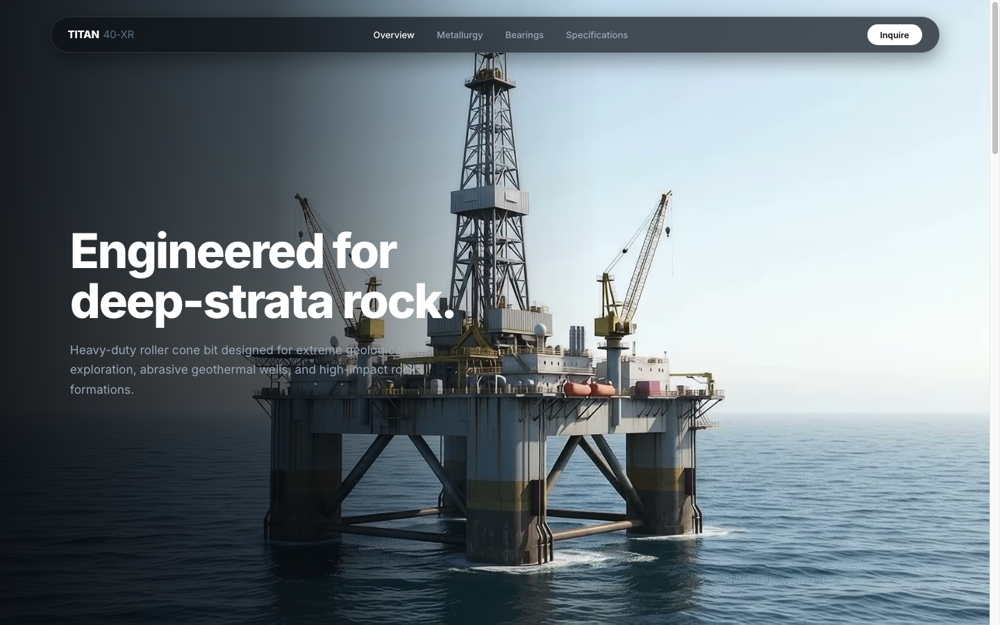

# TITAN 40-XR // Cone Drill Industri
> **Swiss Industrial Grid Scroll-Driven Showcase**  
> Built with the `scroll-craft` engine, Vite, and Lenis Smooth Scroll.



## 📌 Overview
Showcase interaktif **Hero Section** mata bor kerucut (*tri-cone rotary roller bit*) untuk industri pengeboran minyak, gas, dan pertambangan geologi keras. Menggabungkan estetika **Swiss Industrial Grid** (modular wireframes, hairline borders, technical telemetry) dengan animasi scroll 50-frame sequence berkecepatan 60 FPS.

---

## 🛠️ Tech Stack & Fitur Utama
* **Scroll-Craft Frame Scrubber:** Canvas 2D Retina 1920x1080 dengan *LERP interpolation* (bebas stutter) dan *graceful fallback* antarframing.
* **Swiss Industrial HUD:**
  * **Mod.01 // System ID:** Header arsitektur Swiss, status grade *Tungsten Carbide WC-Co 12%*, dan klasifikasi *Heavy Duty*.
  * **Mod.02 // Realtime Telemetry:** Dynamic RPM counter, axial load gauge, dan kalkulasi batas termal 1,450°C.
  * **Mod.03 // Performance Index (Ref 1 Style):** Wear resistance ratio (+68%), penetration rate ROP (3.4x), dan skala Mohs 8.5.
  * **Mod.04 // Spec Sheet Matrix (Ref 2 Style - TEKA/KUKA):** Tabel dimensi bit Ø 311.1 mm (12 ¼ in), rating beban 180 kN, dan kelas proteksi IP69K.
* **Signature Move:**
  * **Interactive Pointer Parallax:** Tilt 3D pada modul HUD dan laser reticle yang melacak kursor secara presisi.
  * **Mechanical Synthesizer:** Efek suara klik mekanis ala instrumen caliper presisi tinggi (Web Audio API, toggleable di header).
  * **360° Inspect Action:** Tombol inspeksi otomatis untuk memutar visual 50-frame secara mulus.
* **Lenis Smooth Scroll:** Pengalaman scrolling halus kelas agensi / Awwwards.

---

## 🚀 Cara Menjalankan

```bash
# 1. Masuk ke direktori
cd "cone - drill industri"

# 2. Jalankan server lokal
npm run dev
```

Buka URL lokal yang muncul (default: `http://localhost:5173`) di browser.
